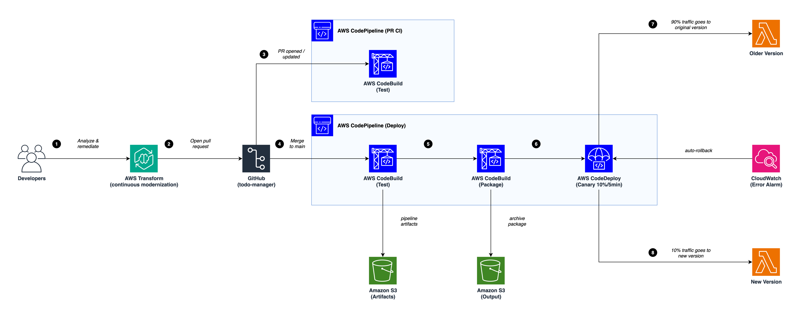

# Python Version Upgrade using AWS Transform continuous modernization and CI/CD

Automate Python 3.8/3.9/3.10 → 3.11/3.12/3.13 upgrades using AWS Transform continuous modernization (CM), then test and ship the result with a CI/CD pipeline built on CodePipeline, CodeBuild, and CodeDeploy.

CM finds the outdated code and opens a remediation pull request on GitHub. This sample adds what CM doesn't cover: CI on that pull request, and a canary deployment to AWS Lambda once it merges.

## Architecture



The diagram source is [`images/CM_arch_diag.drawio`](images/CM_arch_diag.drawio).

### Architecture Flow

**1. Developers analyze and remediate with AWS Transform (CM)**
Developers drive CM from the `atx ct` CLI. A GitHub organization (or user) is added as a CM source with `atx ct source add`, and `atx ct discovery scan` enumerates its repositories. `atx ct analysis run` then scans the repository and records findings, such as code and dependencies that block a move to a newer Python version. Findings carry a severity and, when auto-fixable, the transformation that fixes them.

**2. CM opens a pull request on GitHub**
`atx ct remediation create` applies the AWS managed transformation `AWS/python-version-upgrade`. It upgrades syntax and dependencies, validates the result against the target Python version, pushes a branch, and opens a pull request on GitHub.

**3. AWS CodePipeline: pull request CI (`cm-python-upgrade-pr-ci`)**
The pipeline is connected to GitHub through AWS CodeConnections and triggers when a pull request targeting `main` is opened or updated. The **Test** stage (CodeBuild) creates a virtual environment on the target Python version, installs `requirements.txt`, compiles every source file, and runs `pytest` when tests are present.

**4. Review and merge to `main`**
A reviewer inspects the CM diff and the CI result, then merges. The pull request review is the human gate before deployment; there is no separate pipeline approval. The merge (a push to `main`) triggers the deploy pipeline (`cm-python-upgrade-pipeline`), whose **Test** stage re-runs the same checks on the merged code. Pipeline artifacts are stored in **Amazon S3 (Artifacts)**.

**5. AWS CodeBuild (Package)**
Package installs dependencies, builds `lambda-package.zip`, updates the Lambda function code, upgrades the runtime to the target version (e.g. `python3.13`), publishes a new version, writes an `appspec.json` for the `live` alias, and archives the package to **Amazon S3 (Output)** under `deployed/`.

**6. AWS CodeDeploy (Canary 10%/5min)**
CodeDeploy shifts the `live` alias with `CANARY_10PERCENT_5MINUTES`. A **CloudWatch Error Alarm** (`cm-python-app-errors`, ≥1 error in 1 minute) triggers automatic rollback, as does a failed deployment.

**7. Older Version**
During the 5-minute canary, 90% of traffic stays on the previous Lambda version.

**8. New Version (Python 3.11/3.12/3.13)**
10% of traffic goes to the new version running the CM-remediated code on the target runtime. If no errors are detected during the canary, CodeDeploy shifts 100% of traffic to it.

## Prerequisites

- AWS CLI installed and configured (`aws configure`)
- Node.js 22+ and npm
- AWS CDK CLI (`npm install -g aws-cdk`)
- Git installed
- AWS Transform CLI: `curl -fsSL https://transform-cli.awsstatic.com/install.sh | bash`
- The AWS managed policy `AWSTransformCustomFullAccess` attached to the IAM user or role running `atx`
- A GitHub repository and a personal access token (classic) with the `repo` scope. CM uses it to read the repository, push the remediation branch, and open the pull request.

## Step 1: Push the Sample App to GitHub

Create an empty GitHub repository (e.g. `todo-manager`), then push the contents of `todo_manager/` to its root:

```bash
cd todo_manager
git init
git add .
git commit -m "initial commit"
git branch -M main
git remote add origin https://github.com/<owner>/todo-manager.git
git push -u origin main
cd ..
```

## Step 2: Deploy the CDK Stack

```bash
cd cicd-cdk
npm install
```

Bootstrap CDK (first time per account/region):

```bash
npx cdk bootstrap aws://$(aws sts get-caller-identity --query Account --output text)/${AWS_REGION:-us-east-1}
```

Deploy, pointing the pipelines at your repository:

```bash
npx cdk deploy \
  --context githubOwner=<owner> \
  --context githubRepo=todo-manager
```

Optional context values:

| Context | Default | Description |
|---|---|---|
| `githubBranch` | `main` | Branch that PRs target and that deploys on push |
| `connectionArn` | _(created)_ | Reuse an existing, already-activated CodeConnections connection |
| `sourcePythonVersion` | `3.9` | Initial Lambda runtime: `3.8`, `3.9`, or `3.10` |
| `targetPythonVersion` | `3.13` | Target runtime: `3.11`, `3.12`, or `3.13` |

The supported versions match the range of `AWS/python-version-upgrade`.

Or use the included script:

```bash
chmod +x deploy.sh
GITHUB_OWNER=<owner> GITHUB_REPO=todo-manager ./deploy.sh
```

## Step 3: Activate the GitHub Connection

If the stack created the connection, it starts in **Pending** state. Open the AWS Console → **Developer Tools** → **Settings** → **Connections**, select `cm-python-upgrade-github`, choose **Update pending connection**, and authorize access to the repository. This is a one-time step. Pipeline runs fail at Source until it's done.

## Step 4: Connect CM to GitHub

Add the GitHub organization (or user) as a CM source. `read -s` reads the token without echoing it or saving it to shell history:

```bash
read -s TOKEN && atx ct source add --name my-github --provider github --org <owner> --token "$TOKEN"; unset TOKEN
atx ct discovery scan --source my-github
atx ct repository list --source my-github
```

## Step 5: Analyze with CM

```bash
atx ct analysis run --type tech-debt-comprehensive --source my-github --repo my-github::todo-manager
atx ct analysis get --id <analysis-id>
atx ct findings list --analysis-id <analysis-id> --json
```

`analysis run` prints the analysis ID. Poll `analysis get` until the status is `complete`, then list its findings.

`rapid-techdebt-analysis` is a faster option, but it only inspects package manifests. The sample's `requirements.txt` has no dependencies, so it can come back with zero findings even though the code targets an old Python version.

## Step 6: Remediate with CM

From findings (each finding uses its own fix transformation):

```bash
atx ct remediation create --ids <finding-id1,finding-id2> --name "python-3.13-upgrade"
```

Or run the AWS managed transformation directly against the repository:

```bash
atx ct remediation create \
  --transformation-name AWS/python-version-upgrade \
  --repo my-github::todo-manager \
  -g "additionalPlanContext=The target Python version to upgrade to is Python 3.13"
```

Check the result and get the pull request link:

```bash
atx ct remediation list
atx ct remediation status --id <remediation-id>
```

Poll `remediation status` until the repository shows the pull request link.

## Step 7: CI on the Pull Request

Opening the PR triggers `cm-python-upgrade-pr-ci` automatically:

```bash
aws codepipeline get-pipeline-state \
  --name cm-python-upgrade-pr-ci \
  --query 'stageStates[].{Stage:stageName,Status:latestExecution.status}' \
  --output table
```

## Step 8: Review, Merge, and Deploy

Review the diff on GitHub and merge once CI passes. The merge triggers `cm-python-upgrade-pipeline`:

```bash
aws codepipeline get-pipeline-state \
  --name cm-python-upgrade-pipeline \
  --query 'stageStates[].{Stage:stageName,Status:latestExecution.status}' \
  --output table
```

## Step 9: Review Results

```bash
aws lambda get-function-configuration --function-name cm-python-app \
  --query '{Runtime:Runtime,Version:Environment.Variables.PYTHON_VERSION}' \
  --output table
```

Deployed packages are archived in S3:

```bash
aws s3 ls s3://cm-output-$(aws sts get-caller-identity --query Account --output text)-${AWS_REGION:-us-east-1}/deployed/
```

## Scaling with CM

The steps above target one repository, but the CM side works the same across a portfolio:

- **Whole organizations:** one GitHub source covers every repository in the organization; `discovery scan` enumerates them.
- **Migration waves:** label repositories (e.g. `atx ct repository update --source my-github --repo "my-github::svc-a,my-github::svc-b" --labels "wave:1"`) and filter with `atx ct repository list --labels "wave:1"`.
- **Portfolio-wide analysis and remediation:** run an analysis across a source, then remediate findings in bulk. Each analysis or remediation request covers at most 100 repositories; split larger scopes into batches.
- **Continuous monitoring:** schedule recurring analyses (daily, weekly, or monthly) with `atx ct schedule`, which uses Amazon EventBridge Scheduler.
- **Remote compute:** analyses can run on AWS Transform-managed infrastructure with nothing to provision (`atx ct remote analysis --mode aws-managed`). Remediation runs locally or on an AWS Batch (Fargate) or Amazon EC2 stack provisioned in your account with `atx ct remote` commands.

Each remediated repository opens its own pull request. Deploy this stack once per repository (or adapt it) to get CI and canary deployment for each one.

See the [AWS Transform continuous modernization documentation](https://docs.aws.amazon.com/transform/latest/userguide/continuous-modernization.html) for details.

## Project Structure

```
sample-transform-custom-using-cicd/
├── cicd-cdk/                        # CDK stack (CI/CD infrastructure)
│   ├── bin/app.ts                   # CDK app entry point
│   ├── lib/pipeline-stack.ts        # PR CI pipeline + deploy pipeline
│   ├── deploy.sh                    # One-click deploy script
│   ├── package.json
│   └── tsconfig.json
├── images/
│   ├── CM_arch_diag.png             # Architecture diagram
│   └── CM_arch_diag.drawio          # Editable diagram source
├── todo_manager/                    # Sample Python 3.9 app (source code)
│   ├── main.py
│   ├── models.py
│   ├── manager.py
│   ├── requirements.txt
│   └── README.md
└── README.md
```

## Notes

- CM runs from the `atx` CLI, outside this stack. The stack contains no CM infrastructure and no AWS Transform permissions.
- CI results show in CodePipeline; they are not posted back to the GitHub pull request as a status check. Protect `main` on GitHub (require a pull request review) so changes reach the deploy pipeline only through a reviewed merge.
- Any push to `main` deploys, including changes that didn't come from CM. The Test stage runs on the target Python version, so code that isn't yet compatible stops before Package.
- The Lambda starts at the source Python version intentionally; the Package stage upgrades the runtime to the target version.
- CodeDeploy uses `CANARY_10PERCENT_5MINUTES` with auto-rollback on CloudWatch alarms.
- All S3 buckets enforce SSL and are encrypted with a KMS key (with rotation enabled).

## Cleanup

```bash
cd cicd-cdk
npx cdk destroy --context githubOwner=<owner> --context githubRepo=todo-manager
atx ct source remove --name my-github
```

Delete the remediation branches and the GitHub repository if you no longer need them.

## CM CLI Quick Reference

| Command | Description |
|---|---|
| `atx ct source add --name <n> --provider github --org <org> --token <t>` | Connect a GitHub organization or user |
| `atx ct discovery scan --source <n>` | Discover repositories in a source |
| `atx ct repository list --source <n>` | List discovered repositories |
| `atx ct analysis run --type <type> --source <n> [--repo <n>::<repo>]` | Run an analysis |
| `atx ct analysis get --id <id>` | Check an analysis's status |
| `atx ct analysis list --json` | List analyses |
| `atx ct findings list --json` | List findings |
| `atx ct remediation create --ids <ids> --name <name>` | Remediate findings (opens PRs) |
| `atx ct remediation create --transformation-name <td> --repo <n>::<repo>` | Run a transformation directly on a repository |
| `atx ct remediation status --id <id>` | Check remediation status and PR links |
| `atx ct remediation retry --id <id>` | Retry a failed remediation |
| `atx custom def list` | List available transformation definitions |
