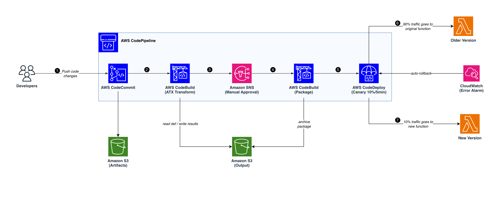

# Python Version Upgrade using AWS Transform custom

Automate Python 3.8/3.9 → 3.11/3.12/3.13/3.14 upgrades using AWS Transform custom (`atx`) with a CI/CD pipeline built on CodePipeline, CodeBuild, and CodeDeploy.

## Architecture



### Architecture Flow

**1. Developers Push Code Changes**
Developers push their Python source code (e.g. Python 3.8/3.9) to the pipeline. This is the entry point — a `git push` to the `main` branch of the CodeCommit repository triggers the entire CI/CD flow automatically.

**2. AWS CodeCommit**
The source code lands in a CodeCommit repository (`atx-python-upgrade-source`). CodePipeline is configured to watch the `main` branch, so any new commit kicks off a new pipeline execution. The source code is packaged as a pipeline artifact and passed to the next stage.

**3. AWS CodeBuild (ATX Transform)**
This is the core transformation stage. CodeBuild spins up a container that includes the ATX CLI image. The build process:
- Downloads the transformation definition from **Amazon S3 (Output)** bucket (`definitions/transformation_definition.md`).
- Publishes the definition to the ATX registry using `atx custom def publish`.
- Initializes a local git repo in the source directory (required by ATX).
- Executes the transformation with `atx custom def exec`, which analyzes the codebase, identifies Python version-specific changes, upgrades syntax, updates dependencies, and validates the result against the target Python version.
- Archives the transformed code as a zip to **Amazon S3 (Output)** under `results/transformed.zip`.
- Pipeline artifacts (the transformed source) are stored in **Amazon S3 (Artifacts)** for the next stage.

**4. Amazon SNS (Manual Approval)**
The pipeline pauses and sends a notification via an SNS topic (`atx-pipeline-approval`). If an approval email was configured during deployment, the reviewer receives an email with a link to review the transformation results. The reviewer can inspect the ATX-transformed code (e.g. via the S3 output or CodeBuild logs) and either approve to continue deployment or reject to stop the pipeline. This human gate ensures no unreviewed code reaches production.

**5. AWS CodeBuild (Package)**
Once approved, this stage prepares the transformed code for Lambda deployment. CodeBuild:
- Installs Python dependencies from `requirements.txt` into the project directory.
- Creates a deployment zip (`lambda-package.zip`), excluding `.git`, `__pycache__`, and `.pyc` files.
- Updates the Lambda function code using `aws lambda update-function-code`.
- Upgrades the Lambda runtime to the target version (e.g. `python3.14`) using `aws lambda update-function-configuration`.
- Publishes a new Lambda version and retrieves the current alias version.
- Generates an `appspec.json` for CodeDeploy, mapping the current version and the new target version for the `live` alias.
- Archives the deployed artifact to **Amazon S3 (Output)** under `deployed/` with a timestamped filename.

**6. AWS CodeDeploy (Canary 10%/5min)**
CodeDeploy takes the `appspec.json` from the Package stage and begins a canary deployment on the Lambda `live` alias using the `CANARY_10PERCENT_5MINUTES` strategy. During the canary window, 90% of traffic continues to go to the **Original Version (Python 3.8/3.9)** while 10% is shifted to the new version. A **CloudWatch Error Alarm** (`atx-python-app-errors`) monitors the Lambda alias for invocation errors (threshold: ≥1 error in a 1-minute period). If the alarm triggers during the canary window, CodeDeploy automatically rolls back to the previous version — both on alarm and on failed deployment.

**7. New Version (Python 3.11/3.12/3.13/3.14)**
During the 5-minute canary period, 10% of traffic is routed to the newly deployed Lambda version running the upgraded Python code. If no errors are detected by CloudWatch during this window, CodeDeploy completes the deployment and shifts 100% of traffic to the new version. The Lambda function is now fully running on the target Python runtime with the ATX-transformed code.

## Prerequisites

- AWS CLI installed and configured (`aws configure`)
- Node.js 18+ and npm
- AWS CDK CLI (`npm install -g aws-cdk`)
- Git installed

## Step 1: Deploy the CDK Stack

```bash
cd cicd-cdk
npm install
```

Bootstrap CDK (first time per account/region):

```bash
npx cdk bootstrap aws://$(aws sts get-caller-identity --query Account --output text)/${AWS_REGION:-us-east-1}
```

Deploy (optionally pass your email for approval notifications):

```bash
npx cdk deploy --context approvalEmail=you@example.com
```

Customize source and target Python versions (defaults to 3.9 → 3.14):

```bash
npx cdk deploy \
  --context approvalEmail=you@example.com \
  --context sourcePythonVersion=3.8 \
  --context targetPythonVersion=3.13
```

Supported versions:
- **Source**: `3.8`, `3.9`
- **Target**: `3.11`, `3.12`, `3.13`, `3.14`

Or use the included script:

```bash
chmod +x deploy.sh
./deploy.sh
```

Note the `RepositoryCloneUrl` from the stack outputs.

## Step 2: Configure Git for CodeCommit

```bash
git config --global credential.helper '!aws codecommit credential-helper $@'
git config --global credential.UseHttpPath true
```

## Step 3: Push Code to CodeCommit

```bash
cd todo_manager
git init
git add .
git commit -m "initial commit"
git branch -M main
git remote add origin <RepositoryCloneUrl from stack output>
git push -u origin main
```

This triggers the pipeline automatically.

## Step 4: Monitor the Pipeline

Via CLI:

```bash
aws codepipeline get-pipeline-state \
  --name atx-python-upgrade-pipeline \
  --query 'stageStates[].{Stage:stageName,Status:latestExecution.status}' \
  --output table
```

Or open the AWS Console → **CodePipeline** → `atx-python-upgrade-pipeline`.

The pipeline will pause at **Manual_Approve**. Review the ATX transformation results and approve to continue deployment.

## Step 5: Review Results

After the pipeline completes, check the deployed Lambda:

```bash
aws lambda get-function-configuration --function-name atx-python-app \
  --query '{Runtime:Runtime,Version:Environment.Variables.PYTHON_VERSION}' \
  --output table
```

Transformed code is also archived in S3:

```bash
aws s3 ls s3://atx-output-$(aws sts get-caller-identity --query Account --output text)-${AWS_REGION:-us-east-1}/results/
```

## Alternative: Run ATX Locally (No Pipeline)

```bash
# Init git in the project (required by atx)
cd todo_manager
git init && git add . && git commit -m "initial"
cd ..

# Publish the definition
atx custom def publish \
  -n "python-version-upgrade-314" \
  --description "Python 3.9 to 3.14 upgrade" \
  --sd ./python-314-def

# Run non-interactively
atx custom def exec \
  -n "python-version-upgrade-314" \
  -p ./todo_manager \
  -c "python3 main.py" \
  -x -t \
  --configuration 'additionalPlanContext=The target Python version to upgrade to is Python 3.14'

# Check results
cd todo_manager && git diff
```

## Project Structure

```
transform-custom-using-cicd/
├── cicd-cdk/                        # CDK stack (pipeline infrastructure)
│   ├── bin/app.ts                   # CDK app entry point
│   ├── lib/pipeline-stack.ts        # Pipeline stack definition
│   ├── deploy.sh                    # One-click deploy script
│   ├── package.json
│   └── tsconfig.json
├── python-314-def/                  # ATX transformation definition
│   └── transformation_definition.md
├── todo_manager/                    # Sample Python 3.9 app (source code)
│   ├── main.py
│   ├── models.py
│   ├── manager.py
│   ├── requirements.txt
│   └── README.md
└── README.md
```

## Notes

- The pipeline makes local git commits only inside CodeBuild. It does not push back to CodeCommit.
- The Lambda starts at Python 3.9 intentionally — the pipeline upgrades both code and runtime.
- CodeDeploy uses `CANARY_10PERCENT_5MINUTES` with auto-rollback on CloudWatch alarms.
- All S3 buckets enforce SSL and are encrypted with a KMS key (with rotation enabled).
- Resume an interrupted ATX session: `atx --resume` or `atx --conversation-id <id>`
- ATX logs: `~/.aws/atx/custom/<conversation_id>/logs/`

## Cleanup

```bash
cd cicd-cdk
npx cdk destroy
```

## ATX CLI Quick Reference

| Command | Description |
|---|---|
| `atx custom def list` | List all transformation definitions |
| `atx custom def publish -n <name> --sd <dir>` | Publish a definition to the registry |
| `atx custom def save-draft -n <name> --sd <dir>` | Save as draft (30-day expiry) |
| `atx custom def exec -n <name> -p <path>` | Execute a transformation |
| `atx custom def get -n <name>` | Get details of a definition |
| `atx custom def delete -n <name>` | Delete a definition |
| `atx --resume` | Resume most recent session |
| `atx update` | Update atx CLI |
